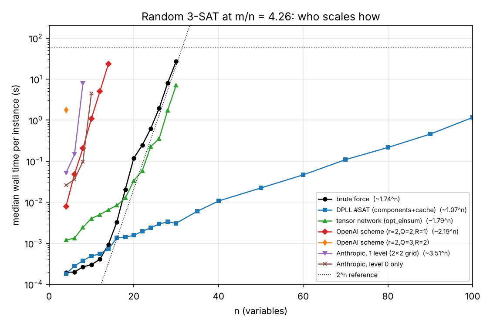
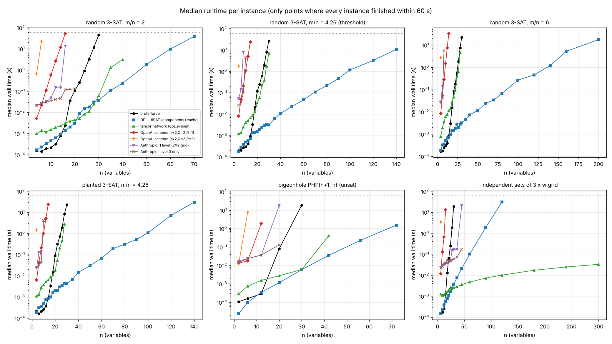
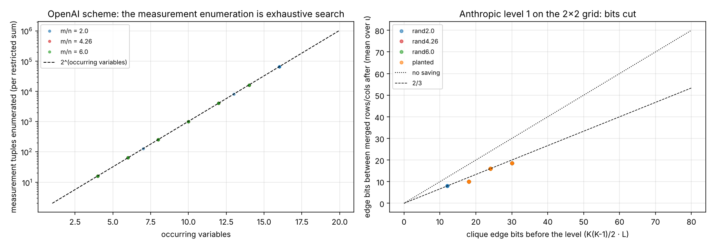
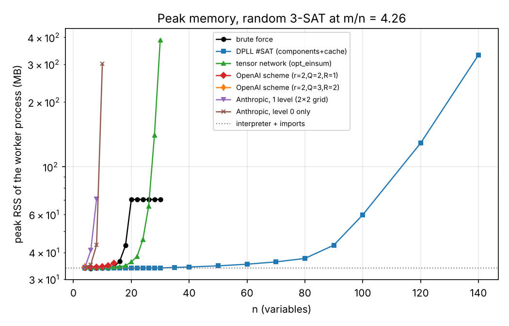
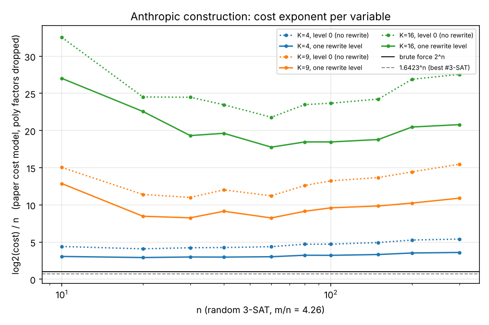
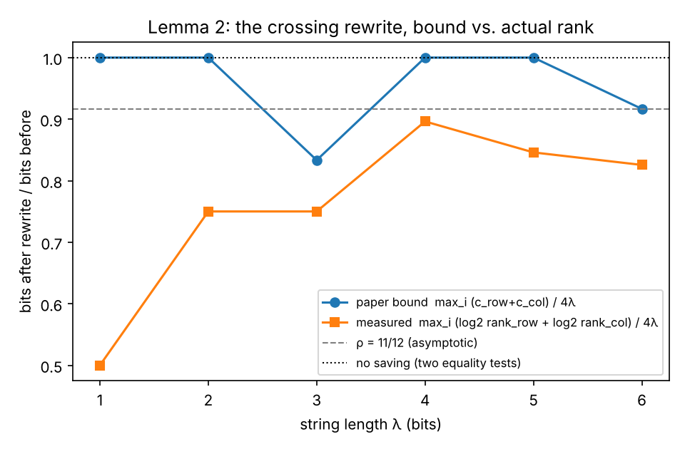
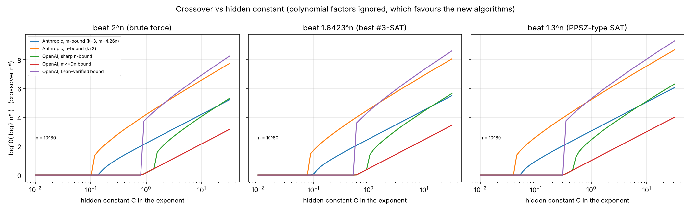
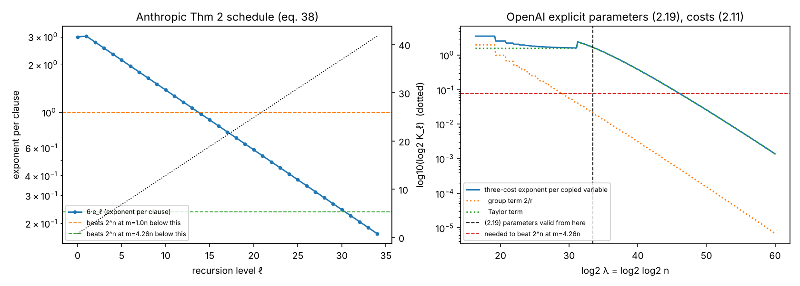

# Sub-exponential #k-SAT, Oct 2026: implementations and an honest empirical look

Papers: **OpenAI**, *The Exponential Time Hypothesis is False* (17/25 Oct 2026), and
**Claude (Anthropic)**, *A 2^o(n) Time Algorithm for 3-SAT* (26 Oct 2026). Both are unreviewed claims.
Summaries, pseudocode and open points are in [`notes/algorithms.md`](notes/algorithms.md). Every
judgement call is logged in [`notes/decisions.md`](notes/decisions.md).

## 1. Executive summary

I implemented the core of both algorithms in Python. The OpenAI scheme (replacement forms, the
M0 = V0 f(W0) construction, measurement designs, Taylor data by inclusion–exclusion, Hermite
interpolation) is structure-faithful with free parameters. For Anthropic, the eight-square
identity, the Lemma 2 pieces with their explicit factorisations, the formula → clique network,
and one level of the Proposition 3 recursion are implemented. Both return exact counts.

All 830 tests pass, including brute-force equivalence on hundreds of random k = 2, 3, 4
instances, unsatisfiable formulas and degenerate clauses. All 504 benchmark instances finished by
more than one method agree across methods (after fixing a precision bug in my own baseline, §3).

**No sub-exponential behaviour is observable, and none should be.** At every size I could run,
both new algorithms are slower than brute force and grow faster than it. Fitted ≈2.2ⁿ for OpenAI's
scheme; for Anthropic's, ≈3.1–3.5ⁿ for one rewrite level, which is consistently slower than
not rewriting at all. A simple DPLL counter with component caching grows ≈1.05–1.2ⁿ and solves
n = 140–200 at the threshold density.

This is what the papers themselves predict. Their parameters are only defined, or only non-trivial,
for astronomically large n. From the papers' own explicit schedules:
- OpenAI's (2.19) parameters are degenerate (r ≤ 1, i.e. exhaustive search) below n ≈ 2^(10^10).
- Its three-cost exponent drops below brute force only around n ≈ 2^(10^12).
- Anthropic's Theorem-2 schedule needs 14–31 recursion levels with K ≈ 2^(10^17) or more nodes.

What *does* check out empirically is the algebra: the eight-square identity, the 11/12 bit saving
of Lemma 2 (actual ranks are even lower than the bound at small λ), and the exactness of both
signed-sum/interpolation schemes. These are correctness facts. They are not evidence for the
asymptotic claims.

## 2. What was implemented: faithful vs simplified

| Component | File | Status |
|---|---|---|
| DIMACS parser/writer; random k-CNF; planted; pigeonhole; grid independent sets | `src/cnf.py` | complete |
| Brute force (numpy, chunked) | `src/baselines.py` | complete |
| DPLL #SAT: unit propagation, connected components, component cache | `src/baselines.py` | complete. A "sharpSAT-lite": no clause learning; branches on the most frequent variable |
| Tensor-network contraction (clause tensors, hyper-indices, opt_einsum path) | `src/baselines.py` | complete. The path finder is opt_einsum `auto` (greedy for large networks), **not** a hyper-optimised path, which matters for n ≥ 40 |
| External counter (sharpSAT-TD / d4) | — | **not available**: no binary installed |
| **OpenAI**: replacement forms, M0 = V0 f(W0), measurement rows, schedules, copies, (r,τ,D)-design evaluation, Taylor data via inclusion–exclusion over (E,U), Hermite interpolation | `src/openai_alg.py` | **structure-faithful, parameters simplified** |
| OpenAI §2.8 reduction (OR gates + Tovey cycles) | `src/openai_alg.py` | faithful, optional (`copy=True`) |
| OpenAI sparsification, §5–6 parity route, Appendix D contraction theorem | — | **not implemented** |
| **Anthropic**: eight-square σ, R/C blocks, Lemma 2 pieces A_i with the explicit integer factorisations through c_row/c_col bits | `src/anthropic_alg.py` | faithful |
| Anthropic §6 network (occurrence bits, chained tests) + Lemma 1 grouping/padding into a (K,L)-clique | `src/anthropic_alg.py` | simplified (local-search grouping, dense tables) |
| Anthropic Proposition 3, one level: grid, Σ_ι over (t+1)^\|R\| terms, row/column merge by smaller U, divide by 2^{t\|R\|} | `src/anthropic_alg.py` | faithful for **one level** on a 2×2 (K = 4) or 3×3 (K = 9) grid |
| Anthropic deeper recursion, Appendix A/B (ρ = 1/√2 pieces), Appendix D (n-bound) | — | **not implemented** (the first real level, K₁ = 9·64¹⁶ nodes, cannot be instantiated) |

### What differs from the papers

**OpenAI**
1. *Parameters.* The paper fixes λ = ⌈log₂n⌉, ν = ⌈log₂λ⌉, r = ⌊√λ/ν²⌋, Q = ⌊λ/(128ν)⌋,
   R = 4⌈√λ⌉ (eq. 2.19). For every n below ≈ 2^(1.2·10¹⁰) this gives r ≤ 1, which is undefined
   or degenerate (§5). I expose (r, Q, R) as free knobs. The construction is exact for any r ≥ 1,
   Q ≥ 1, 1 ≤ R ≤ Q+1. Benchmarks use (2,2,1), the cheapest nontrivial design, and (2,3,2), which
   switches on the Taylor/Hermite machinery. Tests also cover (3,1,1) and (3,2,2).
2. *Arithmetic.* Modulo 31-bit primes plus CRT, instead of exact rationals.
3. *No sparsification and no copying by default.* Correctness only needs deg H ≤ M(R−1) with M
   the real number of occurrences. Tovey copying (the faithful mode) multiplies the enumerated
   variables by ≈ 3m/n ≈ 13 at threshold density. It is tested but too slow to benchmark.
4. *Schedules* are balanced pseudo-random, not Lemma 4.5's derandomisation.
5. *Measurement enumeration* runs only over measurement values that some group assignment reaches.
   The paper enumerates the whole box {−D..D}^c, where every unreached value contributes 0.

**Anthropic**
1. *One level, tiny K.* The paper uses K₀ = 64 and g = 3K⁸ ≈ 8.4·10¹⁴ clusters. I run one level
   on K = 4 in benchmarks; K = 9 was verified on random cliques.
2. *Level 0* is an exact tensor contraction (opt_einsum), or literal brute force over edge strings
   for tiny cliques (used in tests). Same value.
3. *Grouping.* Lemma 1 tries all K^g groupings. I use swap-based local search over balanced
   clause groupings that minimises the largest pair load.
4. *Occurrence chains are in group order.* The paper allows any order. Group order gives at most
   n(K−1) edge bits, instead of ≈ 3m for an arbitrary order.
5. *Dense tables.* The paper evaluates W̃_γ(Θ) lazily per query, which keeps memory polynomial.
   I materialise the merged-part tensors, so memory is 2^(cut bits) and runs stop at L = 6 (`oom`).

## 3. Correctness

`pytest tests/` → **830 passed** (~45 s).

* **Baselines** (`test_baselines.py`)
  * 300 random formulas, n ≤ 20, m ≤ 5n, k ∈ {2,3,4}, with duplicate literals, tautologies,
    repeated and empty clauses: DPLL = TN = brute force.
  * All 2^14 clause sets over 2 variables, checked against a direct count.
  * 10 hand-written edge cases; pigeonhole (PHP); the 4×4 grid (1234 independent sets, OEIS A006506).
  * A regression test against a transfer-matrix count (below).
* **OpenAI** (`test_openai.py`)
  * Invariants: M0 fixes ker C (eq. 2.14) for five (r,Q,R); κ(a) = 0 above deg f; Krawtchouk
    orthogonality.
  * On every run, the algorithm asserts that each replacement form equals X_v at T = 0.
  * §2.8 reduction on 60 random k ≤ 5 formulas: width ≤ 3, ≤ 3 occurrences, count preserved.
  * End to end: 200 instances with R = 1; 40 with R = 2 (25 of them exercise q = 1…4 Taylor
    coefficients and Hermite interpolation; 11 exit early on an empty clause or no clauses);
    20 with `copy=True`; plus the edge cases and PHP.
* **Anthropic** (`test_anthropic.py`)
  * The eight-square identity on all 4096 settings; the cancellation identity (28); R and C factor
    through 3 bits.
  * Lemma 2(a)–(c) for λ = 1..5: Σ A_i = 2^t[x=v][y=u], and the explicit integer factorisations
    reproduce A_i exactly with c_row/c_col bits.
  * One level of Proposition 3 equals brute force on 12 random **signed** K = 4 cliques.
  * End to end: 200 formulas at levels 0 and 1, plus edge cases and PHP.
  * Outside the suite, because of runtime: 3 random signed K = 9 cliques (3×3 grid, 9 rectangles,
    512 signed terms each) agree between level 1 and level 0, at ≈305 s each.
* **Benchmark cross-check.** On every benchmark instance that more than one method finished
  (504 instances), the counts agree.

**The cross-check caught a real bug, in my tensor-network baseline.** Above 52 variables it
switched to exact Python objects, but cast float tensors, so the "exact" path was still float.
On 3×30 and 3×40 grids it was off by 1 and by ≈6·10⁵. Fixed. A regression test now checks the
result against DPLL and an independent transfer-matrix count. The affected runs were redone. A
silent off-by-one in a 17-digit count is exactly what this kind of cross-check is for.

**Caveat.** For cost reasons, the paper algorithms' unit tests use few *occurring* variables (OpenAI
≤ 10 with R = 1, ≤ 6 with R = 2; Anthropic m ≤ 9), although n ranges up to 20. The benchmarks
extend coverage to n = 14–45 at real densities, all cross-checked.

## 4. Runtime, memory and fitted exponents

Setup: 4-core container, one process per instance, 60 s wall-clock timeout. Scaling stops once the
median exceeds 15 s or more than half the instances fail. 10 instances per point for random
m/n = 2 and 4.26, 5 for m/n = 6 and planted, 3 timing repeats for the deterministic families.
Total ≈2 h. Details are in decisions #12. Raw data: `results/runs.jsonl` (2523 runs);
aggregates: `results/summary.csv`, `results/exponents.json`.




**Fitted growth**: slope of log₂(median time) vs n, on points where every instance finished and
the median is > 0.05 s. In brackets: the largest n at which every instance finished.

| method | rand m/n=2 | rand 4.26 | rand 6 | planted 4.26 | PHP | grid IS (3×w) |
|---|---|---|---|---|---|---|
| brute force | 1.84ⁿ (≤30) | 1.74ⁿ (≤30) | 1.78ⁿ (≤30) | 1.73ⁿ (≤30) | — (≤30) | 1.88ⁿ (≤30) |
| DPLL #SAT | 1.19ⁿ (≤70) | 1.07ⁿ (≤140) | 1.05ⁿ (≤200) | 1.08ⁿ (≤140) | — (≤72) | 1.10ⁿ (≤120) |
| tensor network | 1.48ⁿ (≤40) | 1.79ⁿ (≤30) | 1.84ⁿ (≤28) | 1.89ⁿ (≤28) | — (≤42) | poly (≤300) |
| **OpenAI** (2,2,1) | 2.15ⁿ (≤16) | 2.19ⁿ (≤14) | 2.24ⁿ (≤14) | 2.21ⁿ (≤14) | — (≤12) | 2.16ⁿ (≤15) |
| **OpenAI** (2,3,2) | — (≤6) | — (≤4) | — (≤4) | — (≤4) | — (≤6) | — (≤6) |
| **Anthropic** 1 level | 3.09ⁿ (≤16) | 3.51ⁿ (≤8) | — (≤6) | — (≤8) | — (≤20) | 1.31ⁿ (≤45) |
| Anthropic level 0 only | ~1.0ⁿ* (≤20) | — (≤10) | — (≤8) | — (≤10) | — (≤20) | 1.04ⁿ* (≤45) |

How to read the table:
* **Brute force's measured base is below 2** because of per-chunk numpy overhead and an early exit
  once a chunk has no surviving assignment. Its true cost is Θ(2ⁿ·m).
* **OpenAI's scheme at (2,2,1) is slightly worse than 2ⁿ, as it must be.** The number of
  measurement tuples it enumerates is *exactly* 2^(occurring variables) on every instance
  (figure below, left). At these sizes the "measurements" separate every assignment, so the
  measurement enumeration *is* exhaustive search, and Python per-tuple overhead plus per-clause
  polynomial work comes on top. With R = 2, the Taylor/inclusion–exclusion layer multiplies this
  by C_q = Σ_{j≤q} C(n,j)2^j; with q ≈ n it reaches 3ⁿ, so n ≤ 6.
* **Anthropic runtimes are a step function of L** (bits per clique edge), not of n, so fitted
  bases (*) are unreliable. Runs end by memory (`oom` at L > 6, 42 runs) or time, at n = 8–20 on
  random formulas. On the structured grid family, L stays small and n = 45 is reached.
* **One rewrite level is slower than level 0 everywhere we can compare.** For example, at
  m/n = 2: 0.15 s vs 0.04 s at n = 12, and 13.4 s vs 0.12 s at n = 16. This is the paper's own
  prediction for small K: its first level has e₁ ≈ 1.03 > e₀.
* **DPLL wins every random family by a mile.** At threshold or higher densities most instances
  are unsatisfiable or have tiny counts, and unit propagation dominates. **TN contraction wins the
  low-treewidth structured families** (3×w grid: 0.03 s at n = 300; PHP to n = 42).



**Memory** (peak RSS, worker process; the interpreter plus imports is ≈34 MB):
* OpenAI is flat (≈35 MB): it streams, as the paper's polynomial-space claim says.
* Anthropic grows with 2^(cut bits): 101 MB at n = 16, then `oom` once the dense row tensors would
  exceed ~2 GB (L ≥ 7).
* TN grows with contraction width: 389 MB at n = 30, threshold density. Its failures at n ≥ 35–50
  on random formulas are OOM kills (13) and timeouts (13): the greedy path's intermediates
  explode.
* DPLL's component cache reaches 331 MB at n = 140.



### Anthropic cost model, beyond executable sizes
The construction can be costed without contracting anything: build the clique, count L, the edge
bits S₀, the merged cut S₁ (mean over ι), the number of terms, and the largest group. Do this with
the paper's accounting and polynomial factors dropped (`scripts/anthropic_cost_model.py`,
random 3-SAT at m/n = 4.26, n up to 300). The results:

* For K = 4, **log₂ cost ≈ 3–3.6·n after one rewrite level** (≈4.1–5.4·n without), against n for
  brute force. Larger K is *worse* at these sizes: ≈ 8–11·n for K = 9 and ≈ 18–27·n for K = 16.
  Padding every pair to the maximum load L wastes bits, and the number of pairs grows as K².
* **The rewrite cuts S₁/S₀ to ≈ 0.60. Most of that is merging, not the identity.** On a 2×2 grid,
  merging rows alone already cuts 6L to 4L (0.67). The eight-square rewrite takes the diagonal
  half of that down by ≈ 11/12-ish. Merging is something any contraction order gets for free.
  The identity's own contribution at K = 4 is ≈ 10%.



### Lemma 2: the claimed saving vs actual ranks
`scripts/identity_stats.py` measures the matrix rank of every piece A_i in both directions
(λ ≤ 6). The paper's bit counts are upper bounds, and they hold. The actual ranks are lower:
* For A₀, the rank in the cheap direction is exactly 2^λ.
* The row + column total is 0.83 × 4λ at λ = 6, against 0.92 for the paper's bound and 11/12
  asymptotically.

A rational (non-integer) rank factorisation would do strictly better than the paper's integer
θ-encoding at these λ. I did not test whether that survives for large λ.



## 5. Crossover analysis

Two complementary estimates, both from the papers' bounds as stated (`scripts/crossover.py`,
`results/crossover.json`).

**(A) Hidden constants as a parameter.** Each headline bound is 2^(C·g(n)) with C unknown (neither
paper makes C explicit; Anthropic says the Lean constant is "not explicit"). For each C, solve for
the smallest n* that beats 2ⁿ, Kutzkov's 1.6423ⁿ for #3-SAT, and 1.3ⁿ (PPSZ-type, decision only).
Polynomial factors are ignored, which favours the new algorithms.

| bound | C = 0.3 | C = 1 | C = 3 |
|---|---|---|---|
| Anthropic, 2^(C·k·m/√log m), m = 4.26n, vs 2ⁿ | n* ≈ 2^13 | 2^175 | 2^1570 |
| Anthropic, same, vs 1.6423ⁿ | 2^27 | 2^343 | 2^3060 |
| Anthropic, 2^(C·k²·n·loglog n/√log n), vs 2ⁿ | 2^656 | 2^17 000 | 2^250 000 |
| OpenAI sharp, 2^(C·n·ln ln n/√ln n), vs 2ⁿ | trivial† | trivial† | 2^462 |
| OpenAI sharp, vs 1.6423ⁿ | trivial† | 2^24 | 2^1235 |
| OpenAI Lean-verified, 2^(C·n(ln ln n)²/√ln n), vs 2ⁿ | trivial† | 2^9 200 | 2^318 000 |

† "Trivial" means the bound sits below the target for every n ≥ 2, which only says that C is
unrealistically small. That is the point of this section: **the crossover is set entirely by
constants the papers leave open.** Over C ∈ [0.3, 3] it moves from "immediately" to beyond
2^(10^5). The asymptotic statements carry no information about any feasible n.



**(B) The papers' own explicit schedules.** These have no free constants, only dropped
polynomial factors.

* **OpenAI, (2.19) parameters + three costs (2.11).**
  * The parameters become *valid* (r ≥ 2, 6R ≤ Q) only at log₂log₂n ≈ 33.5, i.e. n ≈ 2^(1.2·10¹⁰).
    Below that, r ≤ 1 and the algorithm is exhaustive search. This matches Szeider's independent
    figure of 2^(1.09·10¹⁰), as cited by Majdoddin.
  * Run on Tovey-copied formulas (≈3m variables), the per-variable exponent falls below brute force
    at log₂log₂n ≈ 40.6 for m = n, and ≈ 46 for m = 4.26n: n ≈ 2^(10^12)–2^(10^14).
  * The Taylor term dominates throughout. Groups (2/r) and measurements are negligible once valid.
* **Anthropic, Theorem 2 schedule (38)** (K₀ = 64, K_{ℓ+1} = 9K_ℓ¹⁶, ρ = 11/12).
  * To beat 2ⁿ at m = n needs 6e_ℓ < 1: ℓ = 14 levels, K ≈ 2^(4.5·10¹⁷).
  * At m = 4.26n it needs ℓ = 31, K ≈ 2^(1.3·10³⁸).
  * The additive grouping overhead log₂(K^g) = 3K⁸log₂K is itself astronomically larger.
  * The paper's stronger Theorem 1 (Appendix A/B) is better. The paper states n > 10^10000 at
    m = 5n. Majdoddin's follow-up (arXiv 2610.41622, also unreviewed) lowers the m-bound crossover
    to ≈ 2^420 clauses at m = n, from 2^33858.



**Bottom line.** Even the most optimistic published crossover (≈2^420 clauses) is about 10^126.
That is far beyond anything executable, so no experiment at any feasible scale can show the
asymptotic advantage. The only empirical questions that make sense are correctness, which holds,
and the behaviour of the ingredients, which section 4 covers.

## 6. Comparing the two approaches

**Conceptually.** Both make "the sum doesn't factor" cheap by paying a polynomial number of extra
terms, so that the pieces interact only through a small summary.
* Anthropic's summary is the θ-bits crossing a cut. The extra terms are the (t+1)^|R| signed
  networks from the octonion (eight-square) identity, each contracted in its own order.
* OpenAI's summary is the integer measurements ȳ. The extra terms are the Taylor coefficients at
  Q points, with an inclusion–exclusion over (E,U).

Anthropic is rank-theoretic and recursive. OpenAI is interpolation-theoretic and flat, in its main
text. The convergence is that both papers' strongest bounds go through **tensor-network
contraction**: Anthropic's whole method, and OpenAI's Appendix D (Theorem D.1, a contraction
theorem for bounded-degree Boolean networks in 2^O(s/√log s)).

**Cost driver.**
* Anthropic's natural parameter is clause-graph bits (≈ m), and its tables need the formula's
  occurrence structure. The n-bound needs a separate construction (Appendix D) that I did not
  implement.
* OpenAI's natural parameter is variables. But the bounded-occurrence reduction it relies on
  inflates the variable count to ≈ 3m, which at threshold density makes its main-text route worse
  than Anthropic's in the constant.

**In practice** (this repo):
* OpenAI streams in constant memory and degrades gracefully to exhaustive search.
* Anthropic's dense implementation is memory-bound. A lazy-table version would trade that back
  into time.
* Neither is close to DPLL or TN contraction at any feasible size. Both are 10³–10⁵× slower than
  brute force at n = 14–16.

**Implementation difficulty.**
* OpenAI was the harder one to get right: auxiliary label space, copies, the κ/Krawtchouk
  expansion of M0, the Taylor shift with a separate formal input, Hermite solve. About 550 lines.
  It worked on the first exact comparison, but only because each invariant (M0 fixes ker C,
  forms at T = 0) was asserted separately.
* Anthropic's algebra is small (σ, R, C, the A_i via a T-polynomial). The bookkeeping of grid
  copies, diagonal strings and merges is where the bugs live. About 480 lines.
* Neither paper's *full* algorithm is implementable as written. Anthropic's first real level is
  too large to instantiate, and OpenAI's parameters are undefined at feasible n.

## 7. Limitations and open questions

**Limitations of this study**
* Only one recursion level (Anthropic) and free parameters (OpenAI). These are the *core*
  mechanisms, not the asymptotic algorithms. Nothing here tests the papers' main theorems. That
  is the job of the ongoing human review and of the Lean developments, neither of which I read.
  The Lean source was out of reach in this session.
* Python implementations: constant factors are 10–1000× worse than C++. The *exponents* would not
  change, and that is the claim the report makes.
* Timeouts of 60 s and 5–10 instances per point, instead of the requested 10 min and ≥ 10.
  Exponent fits use 3–10 points over narrow n ranges and are indicative only.
* The baselines are modest: no sharpSAT-TD/d4/ganak, and a greedy TN path. Real counters would
  widen the gap.

**Things in the papers that looked unclear or deserve scrutiny**
1. *What Lean checks vs what the papers claim.*
   * OpenAI's Lean result is the **weaker** bound 2^(O(n(log log n)²/√log n)). The headline
     n·log log n/√log n bound and Appendix D are paper-only.
   * Anthropic's Lean statement uses a Turing-machine step count with one constant C for all k.
     Its appendix says no person had checked the Lean development at the time of writing, and
     its constant is not explicit.
   * Both papers say, correctly, that no machine checks that the formal statement means the
     informal one.
2. *Anthropic grouping (Lemma 1).* Existence of a "good" grouping needs g = 3K⁸. The algorithm then
   tries all K^g groupings, a constant in theory and the dominant cost in any realistic estimate.
   The overview's "time 2^(3e_ℓ m+O(m/K))" hides this. It is legitimate for an o(n) statement but
   should not be read as a practical cost.
3. *Anthropic's "4/9 lower bound for single contraction trees".* The paper says it escapes this
   model by contracting different terms in different orders. Our cost model suggests that at small
   K most of the measured saving comes from the merge (a contraction order), not the identity.
   Whether the identity's share grows with K, as the recurrence needs, is a quantitative question
   our sizes cannot answer.
4. *OpenAI degree bound.* The text uses deg H ≤ MR (M ≤ 3n). With M(R−1) it holds, and Hermite
   interpolation never became inconsistent in ~90 R = 2 runs (40 tests + 50 benchmark), but I did not check the general-factor
   §3 statement line by line.
5. *OpenAI interval endpoints.* A₀ = ⌊Qp − (R−1)/2⌋ is my reading of a formula whose floor
   brackets were lost in text extraction. Any interval of R integers gives a correct algorithm;
   only the cost changes.
6. *"2^o(n)" phrasing.* Both titles say 2^o(n), while the proved rates are 2^(n/√log n)-type.
   Jelani Nelson's reported reading is that both proofs reach ≈ exp(O(n/√log n)). This is
   consistent, but the headline overstates what is new in practice: the improvement over
   1.3ⁿ–2ⁿ algorithms starts at sizes no computer will see.

**Open questions**
* Are the Lemma 2 ranks asymptotically below 11/12, as λ ≤ 6 suggests (0.83)? If so, Appendix B's
  1/√2 might be improvable, or there may be a rank floor (Majdoddin discusses floors).
* Is there a common contraction theorem behind both papers? OpenAI's Theorem D.1 reads like it
  could subsume Anthropic's clique recursion.

## 8. Follow-up ideas

1. **Signed rewrites as a contraction heuristic.** The useful practical question is not
   "sub-exponential?" but "can a sum of (t+1) differently ordered networks beat the best *single*
   contraction tree on real instances with a few dense crossings?" Test it inside a
   cotengra-style optimiser: apply the eight-square rewrite only to crossings whose removal
   lowers the best tree's width by more than log₂(t+1). Our numbers say it does not pay at
   K = 4, where merging does the work. A targeted test on bounded-treewidth networks with planted
   crossings would settle it cheaply.
2. **Rational low-rank factorisations of the pieces** (measured ranks < paper bits) as a drop-in
   improvement. Check how the rank ratio scales for λ = 7–12 with modular rank computations.
3. **OpenAI measurements as hashing.** At small n the measurements fully separate assignments.
   Choosing coarser measurement rows (fewer ψ, lower D) trades exactness of the design for
   collisions. Studying collision counts could give a randomised approximate counter. Speculative.
4. **Run the Lean checks** (both repos) and compare each formal statement to the paper.
5. Re-run the benchmarks against sharpSAT-TD/d4/ganak, with cotengra hyper-optimised paths for TN.
   That changes the baseline picture, not the conclusion about the new algorithms.

## Reproduce

```bash
pip install numpy scipy opt_einsum matplotlib pytest
cd experiments/sharp-ksat
python -m pytest -q tests                       # 830 tests, ~45 s
python scripts/run_experiments.py --timeout 60  # ~2 h on 4 cores -> results/runs.jsonl
python scripts/analyze.py                       # summary.csv, exponents.json, figures
python scripts/identity_stats.py                # Lemma 2 ranks
python scripts/anthropic_cost_model.py          # cost model up to n = 300
python scripts/crossover.py                     # theoretical crossovers
```
